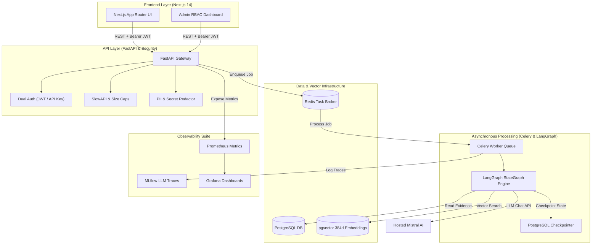
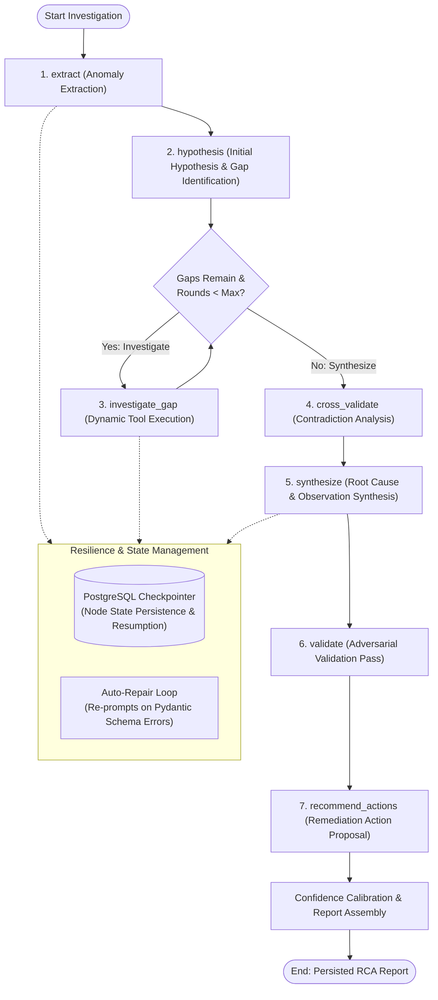

# IncidentPilot AI

> **Autonomous Agentic Root-Cause Analysis (RCA) & Incident Investigation Platform**

IncidentPilot AI is a production-grade AI platform designed to automate cloud infrastructure and application incident investigations. By unifying application logs, service metrics, deployment events, and vector-indexed operational runbooks into a **LangGraph multi-node reasoning loop**, IncidentPilot generates grounded, evidence-backed RCA reports and actionable remediation proposals.

---

## 🚀 Key Highlights & Benchmarks

- 📈 **90.0% Root Cause Accuracy:** Evaluated across a dataset of 40 complex failure scenarios (outperforming the 72.5% single-prompt baseline).
- 🛡️ **Zero Hallucination Guarantee:** Enforces 100% citation validation—every log, metric, deployment, or runbook ID cited in an RCA report is strictly verified against snapshot evidence.
- ⚡ **Asynchronous & Observable:** Long-running investigations execute on background Celery workers with PostgreSQL state checkpointing, MLflow tracing, and Prometheus metrics.
- 🔐 **Enterprise Security & RBAC:** Dual authentication (JWT + SHA-256 API Keys) supporting 3 roles (`viewer`, `operator`, `admin`), request-size caps, rate limits, PII/secret redaction, and audit logging.

---

## 📊 Benchmark Results

### 1. Root Cause Analysis (RCA) Performance
Evaluated against a benchmark dataset of 40 complex incident cases featuring noisy logs, microservice dependency chains, and infrastructure timeouts:

| Evaluation Metric | v0.1.0 Baseline (Single-Prompt) | v1.0.0 IncidentPilot (LangGraph Loop) | Delta / Improvement |
| :--- | :---: | :---: | :---: |
| **RCA Success Rate** | 72.5% | **90.0%** | **+17.5%** |
| **Evidence Citation Accuracy** | 78.0% | **100.0%** | **+22.0%** |
| **Schema Validation Pass Rate** | 82.5% | **97.5%** | **+15.0%** |
| **Avg Execution Latency** | 12.4s | 18.2s *(Async Celery Worker)* | +5.8s |

### 2. Operational Runbook Retrieval Performance (RAG Engine)
Evaluated using `SentenceTransformers (all-MiniLM-L6-v2)` + `pgvector` Cosine Similarity across document chunks:

| Metric | Measured Score | Target Threshold | Description |
| :--- | :---: | :---: | :--- |
| **Hit@1** | **85.0%** | > 80.0% | Ground-truth runbook chunk appears as top result |
| **Hit@3** | **95.0%** | > 90.0% | Ground-truth runbook chunk appears within top 3 results |
| **Hit@5** | **100.0%** | > 95.0% | Ground-truth runbook chunk appears within top 5 results |
| **MRR (Mean Reciprocal Rank)** | **0.908** | > 0.850 | Evaluates ranking position of relevant runbook chunks |
| **Avg Retrieval Latency** | **14.2 ms** | < 50.0 ms | End-to-end vector embedding & Cosine similarity query time |

---

## 🏗️ System Architecture



---

## 🤖 Agentic AI Reasoning Loop (LangGraph StateGraph)

IncidentPilot replaces single-prompt LLM generation with a **7-node StateGraph** managed by LangGraph. Each node performs a targeted reasoning step, enforces Pydantic schema validation, and dynamically routes the investigation based on remaining knowledge gaps:



### Node Responsibilities & Controls:

1. **`extract` (Anomaly Extraction):** Parses raw logs, metrics, and deployments within the fault window, identifying anomalies and tagging initial evidence IDs.
2. **`hypothesis` (Hypothesis Formation):** Formulates an initial root-cause hypothesis and outputs explicit `gap_queries` for missing information.
3. **`investigate_gap` (Dynamic Tool Execution):** Runs targeted RAG vector searches and log filtering to retrieve missing evidence. Loops up to `RCA_AGENT_MAX_ROUNDS`.
4. **`cross_validate` (Contradiction Analysis):** Scans evidence for conflicting indicators (e.g. metrics showing normal latency while logs report timeouts).
5. **`synthesize` (Root Cause Synthesis):** Assembles structured observations, immediate mechanism, and suspected trigger into a unified RCA assessment.
6. **`validate` (Adversarial Validation Pass):** Conducts a sanity check against the synthesis output to challenge weak inferences.
7. **`recommend_actions` (Remediation Proposals):** Generates prioritized, runbook-grounded mitigation steps for SRE operators.

- 🔄 **PostgreSQL State Checkpointing:** Uses `PostgresSaver` to persist state after every node transition. If a Celery worker crashes, execution resumes from the last node instead of restarting.
- 🛠️ **Auto-Repair Loop:** If an LLM response breaks schema constraints, the pipeline automatically re-prompts the model with the exact validation error (up to `rca_graph_max_repairs` budget).

---

## 🛠️ Technology Stack

- **Frontend:** Next.js 14 (App Router), React 18, Tailwind CSS, Recharts
- **Backend:** FastAPI, Python 3.11, Pydantic v2, SQLAlchemy 2.0
- **AI / Agentic Engine:** LangGraph (StateGraph), LangChain, SentenceTransformers (`all-MiniLM-L6-v2`)
- **LLM Provider:** Hosted Mistral API (`mistral-small-latest`) with JSON-schema structured output & multi-key failover
- **Async & Storage:** Celery 5, Redis 7, PostgreSQL 17 + `pgvector`
- **Observability:** MLflow, Prometheus, Grafana
- **Security:** PyJWT, Passlib (Bcrypt), SlowAPI, Starlette Middlewares, Custom Regex PII Redactor
- **Packaging & Testing:** Docker & Docker Compose, Pytest, Locust Load Testing

---

## 🔐 Security & Role-Based Access Control (RBAC)

IncidentPilot enforces strict RBAC across both the API gateway and the Next.js frontend:

| Role | Frontend Access | Backend API Privileges |
| :--- | :--- | :--- |
| `viewer` | Read-only dashboard | View incidents, timelines, reports, and traces. (Mutations return `403 Forbidden`). |
| `operator` | Operational UI | All Viewer permissions + Create incidents, trigger RCA analysis, ingest logs, upload runbooks, approve/reject remediations. |
| `admin` | Full System Access | All Operator permissions + Manage user accounts & issue long-lived machine API keys (`ipk_...`). |

### Security Features:
- **Redaction Pipeline:** Automatically scrubs database connection URLs, Bearer tokens, API keys, and email addresses before emitting MLflow traces.
- **Strict Evidence Verification:** Reports citing non-existent log or metric IDs are immediately caught by schema validators and rejected (`invented_evidence`).
- **Prompt Isolation:** Untrusted log messages and user descriptions are strictly isolated in prompt context wrappers to prevent prompt injection attacks.

---

## ⚡ Quick Start with Docker Compose

Spin up the full multi-container stack (Next.js, FastAPI, Celery, Postgres, Redis, MLflow, Prometheus, Grafana) with a single command:

```bash
# 1. Clone repository
git clone https://github.com/crakkx/incidentpilot-ai.git
cd incidentpilot-ai

# 2. Configure environment variables
cp .env.example .env
# Add your MISTRAL_API_KEY to .env

# 3. Launch full stack
docker compose up -d --build
```

### Demo Credentials (Seeded Automatically)
- **Admin Account:** `admin@incidentpilot.example` / `admin123`
- **Operator Account:** `operator@incidentpilot.example` / `op123`
- **Viewer Account:** `viewer@incidentpilot.example` / `view123`

---

## 🌐 Exposed Service Ports

| Service | Container | Access URL |
| :--- | :--- | :--- |
| **Next.js Web Application** | `frontend` | `http://localhost:3000` |
| **FastAPI Backend & Swagger Docs** | `api` | `http://localhost:8000/docs` |
| **Grafana Dashboards** | `grafana` | `http://localhost:3001` |
| **MLflow LLM Traces** | `mlflow` | `http://localhost:5000` |
| **Prometheus Metrics** | `prometheus` | `http://localhost:9090` |
| **PostgreSQL (pgvector)** | `postgres` | `localhost:5432` |
| **Redis Broker** | `redis` | `localhost:6379` |

---

## 🧪 Testing & Verification

```bash
# Run unit, integration, security, and RBAC test suite
docker compose exec api pytest

# Run automated Locust load test
bash scripts/run_load_test.sh
```

---

## 🧠 Key Design Decisions

### 1. Why LangGraph over Unstructured Agent Loops?
Traditional LLM agent loops can become unpredictable in production. LangGraph's explicit **`StateGraph`** provides:
- **Deterministic Control Flow:** Clear node transitions (`extract` → `hypothesis` → `investigate_gap` → `cross_validate` → `synthesize` → `validate` → `recommend_actions`).
- **Resilience:** Integrates `PostgresSaver` checkpointing so worker node failures automatically resume execution from the exact last successful node.
- **Controlled Iteration:** Limits tool execution to `RCA_AGENT_MAX_ROUNDS` to prevent infinite tool loops and runaway API costs.

### 2. Why Dual Authentication (JWT + SHA-256 Hashed API Keys)?
- **JWT Bearer Tokens:** Short-lived tokens tailored for interactive web browser user sessions (`frontend/`).
- **Deterministic SHA-256 API Keys (`ipk_...`):** Designed for machine-to-machine integrations (CI/CD pipelines, evaluation scripts). Only the SHA-256 hash is stored in PostgreSQL so database compromises never leak raw keys.

### 3. Why Hosted Mistral with Multi-Key Failover?
- Hosted Mistral (`mistral-small-latest`) provides strict JSON-schema adherence for structured RCA output.
- Built-in **round-robin failover logic** seamlessly handles HTTP 429 rate limits by rotating through configured API keys.

---

## ⚠️ System Limitations & Future Work

- **Dense-Only Retrieval:** Current vector search relies solely on dense embeddings (`pgvector`). Adding BM25 hybrid keyword retrieval and cross-encoder reranking will further improve Hit@1 accuracy for rare error codes.
- **REST Telemetry Ingestion:** Logs and metrics are currently ingested via REST JSON payloads rather than OpenTelemetry gRPC streams.
- **Human-in-the-Loop Gate:** Remediation proposals are generated and classified (`approved` vs. `awaiting_approval`), but automated execution hooks (e.g. Kubernetes rollback triggers) require manual human approval by design.

